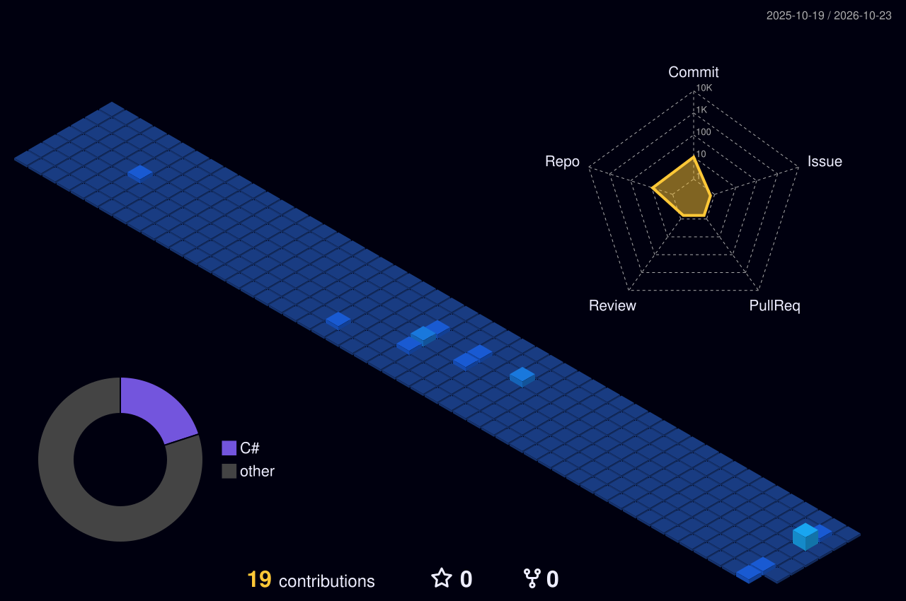

<!-- HERO -->

  

<!-- Social icons section -->
<h1 align="center"> Social Media: </h1>

  
  
  

<!-- Description about me -->
<h2 align="center"> 🤔 Olá, eu sou Bruno Rafael 👋 </h2>

Sou estudante de <b>Análise e Desenvolvimento de Sistemas (ADS)</b> localizado em <b>Caxias - MA</b> 📍  
Tenho forte foco em <b>engenharia de software</b>, <b>arquitetura de banco de dados</b> e <b>desenvolvimento back-end</b> 🖥️  
Busco sempre aplicar boas práticas, princípios de orientação a objetos e modelagem estruturada em meus projetos 📐
  

### 🚀 Sobre mim

- 💻 Atualmente desenvolvendo aplicações e explorando integrações em **C#** e APIs REST com **Python**
- 🗄️ Apaixonado por modelagem de dados e arquitetura relacional (DDL, Stored Procedures, Joins complexos) utilizando **MySQL**
- 🐧 Entusiasta do ecossistema **Linux** (Arch/CachyOS), priorizando fluxos de trabalho eficientes via terminal e customização de ambientes
- 📐 Experiência com levantamento de requisitos, diagramação **UML** (PlantUML/Mermaid) e princípios de IHC (Interação Humano-Computador)
- 🌱 Estudando continuamente segurança da informação e arquitetura de software tri-tier

  

<!-- languages and skills section -->

<h1 align="center"> Linguagens & Back-end: </h1>

  

 

<h1 align="center"> Banco de Dados & Infraestrutura: </h1>

  

 

<h1 align="center"> Engenharia & Ferramentas: </h1>

  
   
  
  

 

<!-- GitHub stats section -->

## 📈 Estatísticas do GitHub

  
    
  

<!-- Projects section -->

## 📘 Meus projetos

<table align="center">
  <tr>
    <td align="center"></td>
    <td align="center"></td>
  </tr>
  <tr>
    <td align="center"></td>
    <td align="center"></td>
  </tr>
</table>

   
  

 

<!-- last activity section -->

## Activity Graph

  

 

<!-- contact -->

## 📫 Como me encontrar

- <a href="mailto:seu-email@exemplo.com">Me envie um e-mail</a>
- <a href="https://linkedin.com/in/seu-linkedin">LinkedIn</a>
